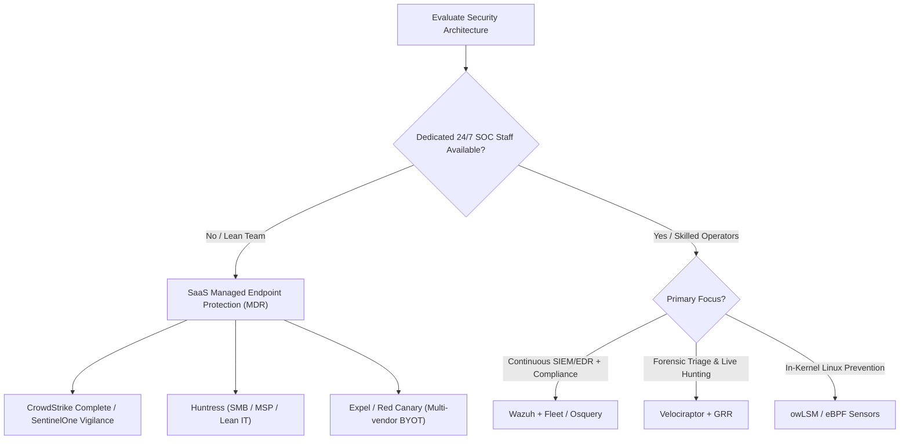

# 🛡️ Awesome Managed Endpoint Protection

  

  
  
  
  
  
  

> 🚀 A curated list of leading **Managed Endpoint Protection**, **Managed Detection and Response (MDR)**, **Managed EDR/XDR services**, and battle-tested **open-source endpoint security tools** for 24/7 threat detection, proactive hunting, and rapid incident containment.

---

## 📑 Table of Contents

- [📊 Sector Overview & Market Dynamics](#-sector-overview--market-dynamics)
- [🏢 SaaS & Hosted Managed Endpoint Protection Platforms](#-saas--hosted-managed-endpoint-protection-platforms)
- [💻 Open-Source Endpoint Detection, Forensics & Response Projects](#-open-source-endpoint-detection-forensics--response-projects)
- [📐 Evaluation Criteria & Architectural Trade-offs](#-evaluation-criteria--architectural-trade-offs)
- [🤝 How to Contribute](#-how-to-contribute)
- [💖 Support & Community](#-support--community)
- [⭐ Star History](#star-history)
- [⚠️ Disclaimer](#️-disclaimer)

---

## 📊 Sector Overview & Market Dynamics

The global **Managed Detection and Response (MDR) and Managed Endpoint Protection** sector is estimated at **$5.1B–$6.2B in 2025–2026**, expanding at a rapid **21–23% CAGR** driven by pervasive cybersecurity skill shortages, advanced ransomware campaigns, and distributed remote-work footprints. The industry exhibits **moderate consolidation at the pure technology platform layer** (dominated by major vendors like CrowdStrike, Microsoft, and SentinelOne) but remains **highly fragmented across managed service delivery**, where specialized MDR providers, boutique SOC operations, and regional MSSPs compete aggressively on human expertise, SLA guarantees, multi-signal telemetry integration, and customized containment runbooks.

---

## 🏢 SaaS & Hosted Managed Endpoint Protection Platforms

Managed Endpoint Protection delivers 24/7 monitoring, AI-driven behavioral telemetry analysis, proactive human threat hunting, and automated incident containment without demanding an in-house Security Operations Center (SOC).

The table below benchmarks the premier SaaS and hosted platforms, sorted by **Company Size (Revenue / Market Cap / Enterprise Valuation) in descending order**:

| Provider / Platform | Company Size (Valuation / Revenue) | Starting Pricing (Specific Baseline) | Free Tier Limits / Free Trial | Key Capabilities & Ideal Fit |
| :--- | :--- | :--- | :--- | :--- |
| **[CrowdStrike Falcon Endpoint Protection Complete](https://www.crowdstrike.com/)** | ~$250B+ Market Cap (~$4.8B FY26 Revenue) | ~$60–$100/endpoint/yr (Falcon Go/Pro baseline); ~$185/endpoint/yr (Falcon Enterprise); Complete adds managed SOC layer (contract minimums apply) | 15-day free trial (Falcon platform modules including Prevent/Insight, up to 25 endpoints, no credit card required) | Industry gold-standard combining Falcon Prevent (NGAV), Insight (EDR), and OverWatch threat hunting with full turnkey surgical remediation by CrowdStrike analysts. |
| **[SentinelOne Vigilance / Singularity](https://www.sentinelone.com/)** | ~$8.9B Market Cap (~$1.0B FY26 Revenue) | $69.99/endpoint/yr (Singularity Core); $179.99/endpoint/yr (Singularity Complete EDR); Vigilance Managed Hunt/Respond available as scoped add-on | 14-day to 30-day guided Proof of Concept (POC) with up to 14 days telemetry retention (partner/sales provisioned, no permanent free tier) | Autonomous client-side behavioral AI detection with patented 1-Click Rollback for ransomware recovery, paired with 24/7 Vigilance human hunting specialists. |
| **[Arctic Wolf Managed Endpoint](https://arcticwolf.com/)** | $4.3B Private Valuation (~$400M+ ARR) | Mid-five-figure entry (~$25,000–$35,000/yr baseline deployment across endpoints/identities; quote-based) | No standard self-service free trial; episodic access via Cyber JumpStart Portal and free guided security posture/readiness evaluations | Delivered via dedicated Concierge Security Teams (CST) providing continuous managed hunting across endpoints, cloud, identity, and network sensors. |
| **[Sophos MDR (Intercept X)](https://www.sophos.com/)** | $3.9B Enterprise Buyout (Thoma Bravo; acquired Secureworks for $859M) | ~$50–$70/endpoint/yr (Intercept X Advanced); ~$100–$110/endpoint/yr (Endpoint + XDR); ~$239/endpoint/yr list (Sophos MDR Complete) | 30-day fully functional free trial (Intercept X Advanced / XDR console; full managed MDR requires scoped partner evaluation) | Comprehensive threat prevention with CryptoGuard anti-ransomware, deep exploit mitigation, and 24/7 analyst response with optional breach protection warranty. |
| **[Huntress Managed EDR](https://www.huntress.com/)** | $1.5B Private Valuation (~$250M+ ARR) | $8.99/endpoint/month (MSRP starting tier; scales down to ~$7.99/endpoint/month with volume commitments) | 14-day fully functional free trial (no credit card required, includes Managed EDR, ITDR, and SIEM for testing on active endpoints) | Tailor-made for mid-market and MSP environments; specializes in detecting persistent footholds, living-off-the-land binaries (LotL), and human-assisted remediation runbooks. |
| **[eSentire Managed Endpoint](https://www.esentire.com/)** | $1.0B+ Private Unicorn Valuation (~$200M+ Revenue) | Custom enterprise baseline starting at ~$15,000–$25,000/yr (multi-signal Atlas platform scoping based on asset volume) | No permanent free tier or self-service trial; scoped enterprise Proof of Value (POV) available upon security specialist consultation | Multi-signal MDR incorporating endpoint, network, log, and cloud intelligence with an average 15-minute Mean Time to Contain (MTTC). |
| **[Expel MDR](https://expel.com/)** | $1.0B+ Private Valuation (~$100M–$140M ARR) | ~$10,000–$11,000/yr minimum entry contract (tiered by Starter, Select, and Premium packages based on telemetry volume) | No self-service free trial or free tier; custom guided product tour and interactive POC evaluations provisioned via sales engineering | Bring-Your-Own-Tech (BYOT) MDR powered by Ruxie agentic AI, auto-triaging benign alerts and surfacing transparent, plain-English investigative steps in <30 seconds. |
| **[Rapid7 MDR](https://www.rapid7.com/)** | ~$900M Market Cap (~$850M FY25 Revenue) | $5.89/asset/month (InsightIDR SIEM/EDR baseline, minimum 500 assets / ~$35,340/yr commitment); Managed Threat Complete quotes custom-scoped | 30-day free trial for underlying InsightIDR / InsightVM software agent; managed MDR delivered via custom scoping engagement | Combines cloud SIEM/EDR telemetry with Rapid7's SOC and threat intelligence engines, integrating vulnerability management and attacker behavior analytics. |
| **[Secureworks Taegis MDR](https://www.secureworks.com/)** | $859M Acquisition Valuation (by Sophos / Thoma Bravo) | ~$80,000/yr enterprise deployment baseline for turnkey MDR; platform-only XDR modules scale from lower annual commitments | 30-day self-service free trial (Taegis XDR agent evaluation on up to 200 endpoints with sample attack simulations and console access) | Battle-tested cloud-native XDR integrating decades of Counter Threat Unit (CTU) threat research with continuous proactive endpoint hunting and automated orchestrations. |
| **[Red Canary MDR](https://redcanary.com/)** | $675M Acquisition Price (acquired by Zscaler; ~$140M+ ARR) | ~$120/endpoint/yr and ~$100/user/yr baseline list (public AWS Marketplace reference pricing; contract minimums apply) | No self-service free trial; tailored Proof of Value (POV) and guided telemetry accuracy tests arranged through engineering specialists | Pioneer of behavioral EDR telemetry analysis boasting 99% threat accuracy, integrated GenAI alert triage, and seamless integration with existing CrowdStrike, SentinelOne, or Microsoft Defender agents. |

---

## 💻 Open-Source Endpoint Detection, Forensics & Response Projects

Open-source tools offer transparency, customizability, and cost-effective telemetry collection. However, **open source provides the tooling, not the human 24/7 SOC team**. Organizations deploying open-source endpoint tooling must provide their own detection engineers and incident responders.

The table below is sorted by **GitHub Stars in descending order**:

| Project | GitHub Stars (Social Link) | Primary Focus & Architecture | Key Strengths |
| :--- | :--- | :--- | :--- |
| **[osquery](https://github.com/osquery/osquery)** |  | SQL-powered OS instrumentation (cross-platform C++) | Exposes an entire operating system as a relational database; allows querying processes, network sockets, open ports, and file hashes via standard SQL. |
| **[Wazuh](https://github.com/wazuh/wazuh)** |  | Full EDR, XDR & SIEM Platform (GPLv2, C/Python/OpenSearch) | The #1 complete self-hosted endpoint defense platform: file integrity monitoring (FIM), CVE vulnerability auditing, configuration assessment (SCA), and active automated response. |
| **[Fleet](https://github.com/fleetdm/fleet)** |  | Enterprise Osquery management & endpoint security (Go) | Real-time endpoint visibility, device management (MDM), live incident investigation across 100k+ enterprise devices, and scheduled GitOps telemetry policies. |
| **[GRR Rapid Response](https://github.com/google/grr)** |  | Enterprise incident response & remote live forensics (Python) | Built by Google for live remote forensic acquisition; collects memory artifacts, file timeline dumps, and scheduled investigations across massive multi-platform fleets. |
| **[Security Onion](https://github.com/Security-Onion-Solutions/securityonion)** |  | Enterprise threat hunting & network/host security monitoring | Turnkey security analytics distribution combining host-based endpoint monitoring (Wazuh/Osquery), Zeek network analysis, Suricata IDS, and Sigma hunt rules. |
| **[Santa](https://github.com/google/santa)** |  | macOS binary authorization & execution control (Objective-C/C++) | Enforces execution policies at the kernel / EndpointSecurity layer on macOS; allows or blocks execution based on binary hash, signing certificate, or path. |
| **[Velociraptor](https://github.com/Velocidex/velociraptor)** |  | Query-driven digital forensics & proactive threat hunting (Go) | Powerful Velociraptor Query Language (VQL); surgical endpoint artifact collection, host isolation, live memory dumping, and swift forensic triage across distributed systems. |
| **[OpenEDR](https://github.com/ComodoSecurity/openedr)** |  | Endpoint telemetry sensor & behavioral logging (C/C++) | Telemetry agent capturing real-time operating system events; historically released by Comodo/Xcitium (*Note: deploy with care due to maintenance considerations*). |
| **[Fibratus](https://github.com/rabbitstack/fibratus)** |  | Windows kernel exploration & behavioral detection (Go/C) | Deep Event Tracing for Windows (ETW) kernel-level telemetry, in-memory YARA scanning, and modular Python 'filaments' for precision threat detection engineering. |
| **[Rustinel](https://github.com/Karib0u/rustinel)** |  | Lightweight modern endpoint detection engine (Rust) | Zero-cloud-dependency EDR engine; parses native Windows/Linux/macOS telemetry and matches Sigma rules, YARA patterns, and IOC databases with minimal memory footprint. |
| **[owLSM](https://github.com/Cybereason-Public/owLSM)** |  | In-kernel Linux Sigma prevention via eBPF LSM (C/Go) | High-performance preventive security engine enforcing detection and prevention logic directly within the Linux kernel using BPF Linux Security Modules. |

---

## 📐 Evaluation Criteria & Architectural Trade-offs

When choosing between **Commercial Managed Endpoint Protection (MDR/Managed EDR)** and **Open-Source Self-Hosted EDR**:

1. 💰 **Total Cost of Ownership (TCO):** Commercial MDR bundles the cost of software licenses, infrastructure, and human shift staffing. Open-source tooling eliminates license costs but incurs significant personnel overhead for rule authoring, log storage, alert tuning, and 24/7 on-call rotations.
2. ⏱️ **Mean Time to Detect (MTTD) & Respond (MTTR):** Top-tier MDR services boast sub-30-minute containment guarantees. Self-hosted stacks depend entirely on internal team responsiveness.
3. 🛡️ **Prevention vs. Investigation:** Tools like **Velociraptor** excel at deep post-incident forensic archaeology ("what happened?"), whereas **SentinelOne**, **CrowdStrike**, and **owLSM** focus on immediate in-line execution interception and behavioral blocking.

---

## 🤝 How to Contribute

1. 🍴 Fork the repository.
2. ✍️ Add or update entries in `README.md` following the tabular layout.
3. 🔍 Verify that all pricing, valuation metrics, and GitHub star URLs are verified and accurate.
4. 🚀 Submit a Pull Request with a clear description of the change.

---

## 💖 Support & Community

Thank you so much for using and exploring this curated guide! If you find this repository valuable for evaluating endpoint defense architectures and managed security providers, please consider supporting the project:

- ⭐ **Star** this repository to help other security practitioners, SOC engineers, and founders discover it.
- 🍴 **Fork** and contribute new entries, verified pricing data, and detection tooling updates.
- 📢 **Share** this resource with your colleagues, infosec networks, and blue team communities.
- ☕ **Buy a coffee / Sponsor**: If you would like to support ongoing curation and security tooling research, you can sponsor via the [GitHub Sponsors Dashboard](https://github.com/sponsors/ishandutta2007).

---

##  Star History

---

## ⚠️ Disclaimer

- 📖 This repository is a community-curated knowledge base created for educational and architectural evaluation purposes.
- ⚖️ Product pricing, features, market capitalization, and enterprise valuations fluctuate based on corporate developments, market conditions, and custom contract negotiations. Always verify quotes directly with official vendor sales teams and authorized channel partners.
